# Ingenium RAG

Proof-of-Concept **Parent-Child Hybrid RAG** pipeline for engineering and construction documents (`.pdf`, `.docx`, `.xlsx`) with metadata filtering (`project`, `building`, `phase`), table-aware chunking, cross-encoder reranking, and citation-grounded retrieval.

- **Stack:** Python 3.11+ · `BAAI/bge-m3` (dense + sparse) · `BAAI/bge-reranker-v2-m3` · Local Qdrant (RRF) · Pydantic v2 · FastAPI · Rich

---

## Architecture & Data Flow

```mermaid
flowchart LR
    SRC["SharePoint / Local Files"] --> ETL["Stage 1: ETL<br/>(src/etl/)"]
    ETL -->|"ParsedDoc"| CHK["Stage 2: Chunker<br/>(src/chunking/)"]
    CHK -->|"ParentChunk[], ChildChunk[]"| EMB["Stage 3: BGE-M3 Embedder<br/>(src/embedding/)"]
    EMB -->|"EmbeddedChildBatch"| DB["Stage 4: Local Qdrant<br/>(src/storage/)"]
    DB -->|"SearchResult[] (RRF)"| RET["Stage 5: Filter + Reranker<br/>(src/retrieval/)"]
    RET -->|"Top-k SearchResult[]"| GEN["Stage 6: Grounded Generator<br/>(src/generation/)"]
    GEN -->|"Answer + Citation[]"| OUT["CLI / FastAPI / Eval"]
```



### Pipes-and-Filters Stage Isolation
Every stage under `src/` is isolated and communicates exclusively through canonical Pydantic contracts and lightweight dataclasses in `src/domain.py`. Stages never import sibling stages; only `src/pipeline.py` wires stages together. This boundary (along with zero `print()` calls in `src/`) is enforced automatically via AST checks in `tests/test_architecture.py`.

| Module | Responsibility |
| :--- | :--- |
| `src/domain.py` | Zero-dependency Pydantic contracts (`ParsedDoc`, `ParentChunk`, `ChildChunk`, `SearchResult`, `RetrievalTrace`, `Citation`, `Answer`) and generic metadata normalization. |
| `src/config.py` | Centralized `Settings` (`pydantic-settings` + `.env`), paths, thresholds, `detect_device()` (`cuda > mps > cpu`), and `configure_logging()`. |
| `src/etl/` | PDF/DOCX/XLSX extractors, SharePoint Graph streaming connector, 3-layer metadata resolution (Document Register → Project Catalog → SharePoint URL / path & cover-page heuristics), and OCR/noise quality audit. |
| `src/chunking/` | Token-accurate `ParentChildChunker` (`BAAI/bge-m3` tokenizer) with orphan-heading packing, Markdown table header repetition across splits, and oversized row sub-splitting. |
| `src/embedding/` | `BGEM3Embedder` generating 1024-dim dense float32 vectors and sparse lexical weights in a single forward pass (FP16 on CUDA/MPS). |
| `src/storage/` | `LocalHybridRepository` over disk-persistent Qdrant (`documents`, `parent_chunks`, `child_chunks`) with native Reciprocal Rank Fusion (RRF), multi-building filtering, and `content_hash` delta sync. |
| `src/retrieval/` | Metadata filter extraction (`query_filter.py` with dynamic `known_buildings` matching), `Searcher`, and `BGEM3Reranker` (`BAAI/bge-reranker-v2-m3`) with finite-score & optional `min_score` guards. |
| `src/generation/` | Grounded prompts, citation formatting, and pluggable `LLMClient` protocol (`ExtractiveStubLLM` default; `OpenAICompatibleLLM` for Ollama/vLLM). |
| `src/evaluation/` | Dataset runner (`json`/`csv`) computing `citation_precision` and `source_recall`. |
| `src/pipeline.py` | Thin orchestrator (`IndexingPipeline` with lazy embedder + length-sorted cross-document batching, `RAGPipeline`, `build_rag_pipeline`). |
| `src/api/` | FastAPI service exposing `GET /health` and `POST /v1/query`. |

---

## Key Capabilities

- **Hybrid Dense + Sparse RRF Search:** Indexes overlapping ~250-token child chunks with both 1024-dim semantic vectors and BGE-M3 lexical weights, deduplicating hits back to ~1000-token parent chunks for full context.
- **Table-Aware Chunking:** Preserves Markdown tables across parent/child splits by repeating the 2-line table header in every slice and sub-splitting oversized single rows cleanly.
- **Incremental `content_hash` Sync:** Skips unchanged documents on re-ingestion without loading BGE-M3 weights (lazy embedder initialization).
- **Project-Agnostic Metadata Filtering:** Resolves generic Flemish construction phases (`Voorontwerp`, `Definitief Ontwerp`, `Aanbesteding`, `Uitvoering`, `As-Built`), dossier/project codes, and structural building labels (`Blok A`, `Vleugel Noord`, `Gebouw 2`, etc.). Multi-building documents store `buildings: list[str]` in Qdrant so exact `MatchValue` filters work out of the box, with optional project-specific aliases via `.env` (`BUILDING_ALIASES`), Project Catalogs, or Document Registers.
- **Pluggable Local LLM:** Runs end-to-end with `ExtractiveStubLLM` by default; point `LLM_BASE_URL` and `LLM_MODEL` to any local OpenAI-compatible server (Ollama, vLLM) to enable full generation.
- **Clean CLI Hygiene:** Strict `stdout` (primary output / pure `jq`-pipeable `--json`) vs. `stderr` (logs, progress, friendly errors) separation across all scripts.

---

## Quickstart & Configuration

### Prerequisites
- **Python 3.11+**
- **Hardware:** Auto-detects `cuda` > Apple Silicon `mps` > `cpu` (FP16 enabled automatically on CUDA and MPS).

### 1. Install & Pre-Download Models
```bash
python3 -m venv .venv
source .venv/bin/activate
make install
make download-models   # caches BAAI/bge-m3 and BAAI/bge-reranker-v2-m3 locally
```

### 2. Configure `.env`
Copy `.env.example` to `.env` in the repository root (gitignored). SharePoint variables are only needed for `MODE=sharepoint`; local file ingestion works without them.

| Variable | Required? | Default | Description |
| :--- | :---: | :--- | :--- |
| `AZURE_TENANT_ID` | SharePoint only | `""` | Microsoft Entra ID tenant ID (alias: `TENANT_ID`). |
| `AZURE_CLIENT_ID` | SharePoint only | `""` | Entra App Registration client ID (alias: `CLIENT_ID`). |
| `AZURE_CLIENT_SECRET` | SharePoint only | `""` | Entra App Registration client secret (alias: `CLIENT_SECRET`). |
| `SHAREPOINT_HOSTNAME` | SharePoint only | `""` | SharePoint host (e.g. `company.sharepoint.com`). |
| `SHAREPOINT_SITE_PATH` | SharePoint only | `""` | Single target site path (e.g. `/sites/12345001-INT`). |
| `SHAREPOINT_SITE_PATHS` | No | `""` | Comma-separated site paths or URLs for multi-site ingestion. |
| `SHAREPOINT_SITES_FILE` | No | `None` | Path to a TSV/CSV site list (`project_code<TAB>url`, e.g. `data/sharepoint_sites.tsv`). |
| `SHAREPOINT_DRIVE_NAME` | No | `Documents` | Document library name. |
| `TEMP_BEARER_TOKEN` | No | `""` | Optional Microsoft Graph Explorer token for quick testing without App Registration. |
| `ETL_WORKERS` | No | `4` | Concurrent worker threads for SharePoint sync and local ETL. |
| `DEVICE` | No | auto | Override compute device (`cuda`, `mps`, or `cpu`). |
| `EMBEDDING_MODEL` | No | `BAAI/bge-m3` | Dense + sparse embedding model ID. |
| `EMBEDDING_BATCH_SIZE` | No | `32` | Per-forward-pass embedding batch size. |
| `EMBEDDING_MAX_LENGTH` | No | `512` | Max token length for child chunk encoding. |
| `EMBED_BATCH_BUFFER_SIZE` | No | `256` | Cross-document child buffer size before length-sorted embedding. |
| `RERANKER_MODEL` | No | `BAAI/bge-reranker-v2-m3` | Cross-encoder reranker model ID. |
| `RERANKER_MIN_SCORE` | No | `0.0` | Minimum normalized reranker score cutoff (override per query via `MIN_SCORE=...`). |
| `RETRIEVE_K` / `RERANK_K` | No | `15` / `5` | Pre-rerank parent pool size and final top-k results. |
| `CHILD_CANDIDATE_LIMIT` | No | `80` | Raw hybrid child hits fetched before parent deduplication. |
| `DEFAULT_PROJECT_NAME` | No | `None` | Optional fallback project display name. |
| `BUILDING_ALIASES` | No | `{}` | Optional JSON map of project-specific zone aliases (e.g. `{"west-wing":"West Wing"}`). |
| `LLM_BASE_URL` | No | `None` | OpenAI-compatible local server URL (e.g. `http://localhost:11434/v1`). Unset → `ExtractiveStubLLM`. |
| `LLM_MODEL` | No | `None` | Model name served at `LLM_BASE_URL`. |
| `LLM_API_KEY` | No | `None` | Optional API key for the OpenAI-compatible server. |
| `HF_HUB_OFFLINE` | No | `0` | Set to `1` to force strict offline HuggingFace cache usage. |

---

## Usage Guide (`Makefile` Workflows)

> **Note:** Local disk-persistent Qdrant (`data/qdrant_poc`) allows one active process at a time. Close `make api` before running `make ingest` or `make query` against the same `QDRANT_PATH`.

### 1. Ingestion & ETL Diagnostics
```bash
# Preview remote or local inventory & inferred metadata (no downloads/extraction)
make ingest-dry-run MODE=sharepoint PREFIX="General/05_Uitvoering"
make ingest-dry-run MODE=sharepoint SITES_FILE=data/sharepoint_sites.tsv
make ingest-dry-run MODE=raw RAW_DIR=data/raw

# Stream from one or more SharePoint sites -> ETL -> chunk -> embed -> Qdrant (indexed per site)
make ingest MODE=sharepoint
make ingest MODE=sharepoint SITE=/sites/12345001-INT PREFIX="General/05_Uitvoering" LIMIT=10 FORCE=1
make ingest MODE=sharepoint SITES_FILE=data/sharepoint_sites.tsv WORKERS=4

# Ingest from a local raw directory (default RAW_DIR=data/raw), or index pre-extracted JSONs (MODE=etl)
make ingest MODE=raw RAW_DIR=data/raw
make ingest

# Inspect extracted documents manifest, scanned-PDF warnings & unauthorized (401/403) targets
make report
```

### 2. Querying
```bash
# Standard query (hybrid RRF + cross-encoder reranking + citations)
make query Q="Wat zijn de eisen voor brandwerende deuren?"

# Filtered query (explicit metadata filters)
make query Q="Wat is het luchtdebiet?" BUILDING="Blok A" PHASE="Uitvoering"

# Debug trace: filters, stage funnel, RRF + rerank scores, matched child & full parent chunks
make query Q="brandwerende deuren" DEBUG=1

# Retrieval-only / skip reranker / custom score cutoff
make query Q="brandwerende deuren" RETRIEVAL_ONLY=1 NO_RERANK=1
make query Q="brandwerende deuren" MIN_SCORE=0.05

# Machine-readable JSON on stdout (pipeable to jq)
make query Q="fire-resistant doors" JSON=1 | jq '.trace.results[0]'
```

### 3. Teammate Inspection, RAGAS Export & Batch Queries
```bash
# Print Qdrant collection counts, metadata distributions, and top documents
make inspect
make inspect JSON=1

# Inspect all parent & child chunks for a specific document ID
make inspect DOC_ID=<16-char-doc-id>

# Export parent_chunks.jsonl and child_chunks.jsonl for RAGAS synthetic dataset generation
make export-chunks OUT=data/exports

# Run a batch of questions (.txt or .json) and write a Markdown or JSON retrieval report
make batch-query QUESTIONS=questions.txt OUT=data/exports/batch_report.md
```

### 4. Evaluation & API Server
```bash
# Evaluate citation precision & source recall on a .json or .csv dataset
make eval DATASET=data/eval_questions.json

# Start FastAPI server on http://127.0.0.1:8000 (GET /health, POST /v1/query)
make api
```

### Complete `Makefile` Reference

| Target | Purpose |
| :--- | :--- |
| `make help` | List all targets and usage examples. |
| `make install` | Editable install with all extras (`etl`, `rag`, `api`, `dev`). |
| `make download-models` | Pre-download `BAAI/bge-m3` and `BAAI/bge-reranker-v2-m3` to local HF cache. |
| `make check` | Pre-PR gate: runs `make lint` + `make test`. |
| `make test` / `make test-cov` | Run offline `pytest` suite (with optional terminal coverage). |
| `make lint` / `make format` | Run `ruff check` / `ruff format` across `src/`, `scripts/`, and `tests/`. |
| `make ingest` | Run ETL + indexing (`MODE=etl\|raw\|sharepoint`, `RAW_DIR`, `ETL_DIR`, `QDRANT_PATH`, `SITE`, `SITES_FILE`, `WORKERS`, `PREFIX`, `LIMIT`, `FORCE`). |
| `make ingest-dry-run` | Preview file inventory and metadata (`MODE=raw\|sharepoint`, `SITE`, `SITES_FILE`, `PREFIX`). |
| `make report` | Print extracted documents summary and logged scanned-PDF / unauthorized / limitation warnings. |
| `make query` | Query the index (`Q`, `PROJECT`, `BUILDING`, `PHASE`, `DEBUG`, `JSON`, `VERBOSE`, `QUIET`, `MIN_SCORE`, `RETRIEVAL_ONLY`, `NO_RERANK`). |
| `make inspect` | Print DB stats & metadata distributions (optional `DOC_ID`, `JSON=1`). |
| `make export-chunks` | Export `parent_chunks.jsonl` and `child_chunks.jsonl` (`OUT`, optional `DOC_ID`). |
| `make batch-query` | Run batch questions from `.txt`/`.json` and save a `.md`/`.json` report (`QUESTIONS`, `OUT`). |
| `make eval` | Run evaluation dataset (`DATASET`) and print precision/recall metrics table. |
| `make api` | Launch FastAPI dev server (`uvicorn api.app:app --reload --port 8000`). |
| `make clean` | Clear Python/pytest/ruff caches (preserves `data/`). |
| `make reset-db` | Wipe local Qdrant storage (`QDRANT_PATH`) after interactive confirmation. |

All CLI entry points are also installed as console scripts (`ingenium-ingest`, `ingenium-query`, `ingenium-inspect`, `ingenium-eval`) and share consistent `-v/--verbose`, `-q/--quiet`, `--json`, and `--qdrant-path` flags.

---

## Project Structure

```text
ingenium-rag/
├── Makefile                    # Unified developer & pipeline commands
├── pyproject.toml              # Dependencies, ruff/pytest config, CLI entry points
├── .env.example                # Documented environment variable template
├── src/
│   ├── domain.py               # Canonical Pydantic contracts & generic normalization
│   ├── config.py               # Centralized Settings, device detection, logging setup
│   ├── pipeline.py             # Top-level IndexingPipeline & RAGPipeline orchestrator
│   ├── etl/                    # Stage 1: PDF/DOCX/XLSX extractors, SharePoint, catalog, quality
│   ├── chunking/               # Stage 2: Table-aware ParentChildChunker
│   ├── embedding/              # Stage 3: BGEM3Embedder (dense + sparse)
│   ├── storage/                # Stage 4: LocalHybridRepository (Qdrant + RRF)
│   ├── retrieval/              # Stage 5: query_filter, Searcher, BGEM3Reranker
│   ├── generation/             # Stage 6: prompts, citations, GroundedGenerator, LLMClient
│   ├── evaluation/             # Dataset runner & citation_precision / source_recall
│   └── api/                    # FastAPI app (/health, /v1/query) & schemas
├── scripts/
│   ├── _cli.py                 # Shared Rich consoles, common flags, friendly error boundary
│   ├── ingest.py               # ingenium-ingest CLI
│   ├── query.py                # ingenium-query CLI
│   ├── inspect_rag.py          # ingenium-inspect CLI (stats, export, batch-query)
│   └── eval.py                 # ingenium-eval CLI
├── tests/                      # Stage-mirrored offline test suite + AST architecture guards
└── data/                       # Gitignored runtime data (raw/, processed/, qdrant_poc/, exports/, logs/)
```

---

## Development & Testing

```bash
make check      # ruff lint + full offline pytest suite (pre-PR gate)
make test       # run pytest offline (HF_HUB_OFFLINE=1, zero network/SharePoint calls)
make test-cov   # pytest with terminal coverage report (requires dev extras)
make lint       # ruff check src/ scripts/ tests/
make format     # ruff format + auto-fix imports
```

The test suite runs completely offline using deterministic fakes for model weights and in-memory Qdrant, and includes automated AST checks in `tests/test_architecture.py` verifying zero horizontal cross-stage imports and zero `print()` calls inside `src/`.

---

## Known Limitations & Roadmap

- **Scanned / image-only PDFs:** Detected and logged to `data/logs/limitations_report.jsonl` (`needs_ocr=True`) rather than running heavy VLM/OCR pipelines; external OCR (e.g., Docling/Tesseract) can be plugged in before re-ingestion.
- **Supported formats:** `.pdf`, `.docx`, and `.xlsx` are extracted; legacy binary `.xls`/`.doc`, CAD (`.dwg`), images, and `.zip` archives are skipped.
- **Single-process local Qdrant:** Local disk mode (`data/qdrant_poc`) locks the storage directory to one process at a time; migrating to a Qdrant server requires only changing `QdrantClient(url=...)` in `src/storage/qdrant.py`.
- **In progress:** Connecting a hosted/local OpenAI-compatible LLM (`LLM_BASE_URL` + `LLM_MODEL`) and expanding RAGAS end-to-end evaluation datasets using `make export-chunks`.
